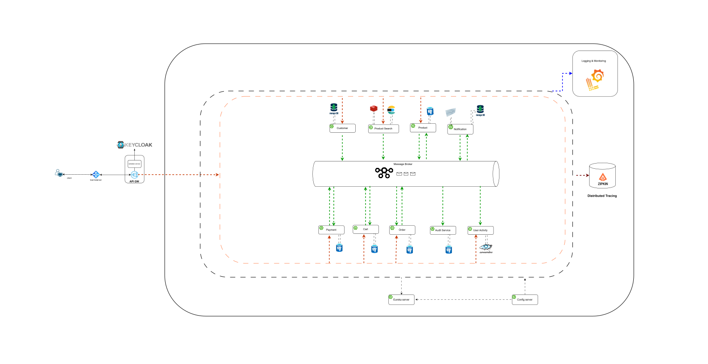

# MegaDeals E-Commerce 

A microservices-based e-commerce platform built with Java and Spring Boot. MegaDeals is designed to demonstrate modern backend engineering practices, distributed systems concepts, and real-world application architecture.

> **Project status:** Under development. Some technologies and features listed below may be planned or partially implemented.

## Overview

MegaDeals aims to provide a complete e-commerce experience, including product discovery, shopping carts, checkout, order management, payment processing, and notifications. Its architecture separates business capabilities into independently managed services.

Key engineering goals:

- Microservices architecture and service communication
- Distributed transactions and consistency
- Secure authentication and authorization
- Product search and caching
- Event-driven communication
- Payment processing and order management
- Observability, monitoring, and fault tolerance

## Architecture Diagram

The diagram below illustrates the current high-level system design.

## System Actors

### Customer
- Register and authenticate
- Browse, search, filter, and sort products
- Manage shopping carts and wishlists
- Apply discount coupons
- Place orders and complete payments
- Track orders and receive notifications

### Administrator
- Manage products and categories
- Manage inventory and orders
- Manage discount coupons
- Access administrative dashboards and system information

### External Payment Provider
- Process payment requests
- Return payment results
- Send payment status updates through webhooks
- Support payment verification and reconciliation

### Internal System / Infrastructure
- Route requests between services
- Handle service discovery and configuration
- Deliver asynchronous events
- Provide logging, monitoring, tracing, and auditing

## Functional Requirements

### Authentication and Authorization
- Customer registration and login
- Authentication and authorization for protected APIs
- Role-based access control
- Secure token/session management

### Product Catalog
- Create, update, delete, and retrieve products
- Manage product categories and product details
- Manage product availability

### Product Search
- Full-text search by product name and description
- Filtering and sorting
- Pagination
- Search result caching

### Shopping Cart and Wishlist
- Add, update, and remove cart items
- Retrieve cart contents and calculate totals
- Validate cart contents during checkout
- Add and remove wishlist products

### Coupons and Discounts
- Create and manage coupons
- Validate coupon eligibility and expiration
- Apply discounts and enforce usage restrictions

### Order Management
- Create orders from cart contents
- Validate order details
- Track order status and order history
- Support cancellation where applicable

### Payment Processing
- Integrate with an external payment provider
- Initiate payment sessions
- Process payment confirmation and webhooks
- Support idempotent payment operations
- Synchronize payment and order statuses

### Inventory Management
- Track product stock
- Validate stock availability
- Reserve or update inventory during checkout
- Release inventory when applicable after failed or cancelled orders

### Notifications and Administration
- Send order, payment, and status notifications
- Provide administrative operations and dashboards
- Retrieve relevant sales and order statistics
- Record important system activities for auditing

## Non-Functional Requirements

### Scalability
- Scale individual services independently
- Support increasing traffic and workloads
- Optimize read-heavy operations where appropriate

### Performance
- Reduce product search and browsing latency
- Cache frequently accessed data
- Use pagination for large datasets
- Avoid unnecessary synchronous service calls

### Availability and Fault Tolerance
- Limit the impact of individual service failures
- Apply timeouts and appropriate retry strategies
- Use circuit breakers where applicable
- Prevent cascading failures

### Security
- Secure authentication and authorization
- Validate requests and enforce access control
- Protect sensitive data and credentials
- Avoid storing sensitive payment details directly
- Secure service-to-service communication where applicable

### Data Consistency and Reliability
- Maintain consistency across distributed business operations
- Use eventual consistency where appropriate
- Apply Saga or other suitable patterns for distributed workflows
- Support idempotent processing for critical operations
- Handle retries, failures, and compensating actions

### Maintainability
- Keep services focused on business responsibilities
- Separate concerns and maintain clear service boundaries
- Follow consistent API conventions
- Apply clean architecture principles where appropriate

### Observability
- Centralize application logs
- Collect metrics and monitor service health
- Trace requests across services
- Track failures and performance

## Technology Stack

| Category | Technology |
|---|---|
| Programming Language | Java |
| Backend Framework | Spring Boot |
| API Communication | REST APIs |
| API Gateway | Spring Cloud Gateway |
| Service Discovery | Netflix Eureka |
| Configuration Management | Spring Cloud Config |
| Relational Database | PostgreSQL |
| NoSQL Database | MongoDB |
| Distributed Cache | Redis |
| Message Broker | Apache Kafka |
| Search Engine | Elasticsearch |
| Payment Integration | Stripe |
| Containerization | Docker |
| Local Environment | Docker Compose |
| Build Tool | Maven |
| Version Control | Git and GitHub |
| Email Testing | MailDev |
| Metrics and Monitoring | Prometheus / Grafana (planned) |
| Centralized Logging | ELK Stack (planned) |
| Distributed Tracing | Zipkin (planned) |

*This table describes the intended stack. Update it as implementation progresses.*

## Microservices and Components

| Service / Component | Responsibility |
|---|---|
| API Gateway | Entry point for client requests and routing to backend services |
| Product Service | Product catalog and product management |
| Product Search Service | Search, filtering, sorting, and search optimization |
| Cart Service | Shopping cart operations |
| Order Service | Order creation and lifecycle management |
| Payment Service | Payment initiation, processing, and status management |
| Notification Service | Notifications and notification event handling |
| Audit Service | Recording important system activities |
| User Activity Service | Tracking relevant user interactions |
| Eureka Server | Service registration and discovery |
| Config Server | Centralized service configuration |

Services are intended to own their business logic and data responsibilities. Actual boundaries and responsibilities may evolve during development.

## High-Level Workflow

### Product Browsing and Search
1. The customer sends a request through the API Gateway.
2. The Gateway routes the request to the relevant service.
3. Product search is handled by the Product Search Service.
4. Elasticsearch retrieves matching documents.
5. Redis may serve cached search results when applicable.
6. The results are returned to the customer.

### Cart and Checkout
1. The customer adds products to the cart.
2. The Cart Service manages cart contents and quantities.
3. The customer initiates checkout.
4. Cart contents, product availability, and pricing are validated.
5. The Order Service creates an order in an appropriate initial state.
6. The Payment Service initiates payment with the external provider.
7. The customer completes the payment.
8. Payment confirmation is received, including through webhooks where applicable.
9. Order, payment, and inventory states are updated.
10. Notifications are sent to the customer.

### Asynchronous Communication
1. A service completes a business operation.
2. It publishes an event to the message broker.
3. Interested services consume the event.
4. Each consumer performs its own local operation.
5. Retry and failure-handling mechanisms help manage unsuccessful processing.

### Distributed Transactions
For workflows spanning multiple services, the system may use the Saga pattern:

- A distributed business operation is composed of local transactions.
- Services coordinate through synchronous calls, asynchronous messages, or a combination.
- Failures may trigger compensating actions.
- Consistency is managed without a single database transaction spanning multiple services.

## Architecture Patterns and Principles

- Microservices Architecture
- API Gateway Pattern
- Service Discovery Pattern
- Centralized Configuration
- Event-Driven Architecture
- Saga Pattern for distributed transactions
- CQRS where justified by requirements
- Cache-Aside pattern for suitable read operations
- Idempotent processing for critical operations
- Separation of transactional data and search-oriented data

Patterns are intended to be applied where they provide practical value, rather than indiscriminately.

## Project Goals

MegaDeals is intended to demonstrate practical experience with:

- Java and Spring Boot backend development
- Microservices design and implementation
- Distributed systems fundamentals
- REST API design
- Database design and optimization
- Event-driven architecture
- Distributed transactions and consistency
- Caching and search optimization
- Payment gateway integration
- Observability and reliability engineering

## License

License information will be added later.
